 

CS undergrad in AI and Data Science. 
I build ML systems, real-time platforms, and the interfaces people touch.

 

## What I work on

- **ML you can trust.** Risk scoring, drift detection, and systems that report their own failure conditions.
- **Real-time platforms.** Event-driven backends in Java and Python, with dashboards on top.
- **Practical tools.** Developer tooling, automation, and browser extensions that solve a concrete problem.

## What I build with

Chosen per project, not collected for a badge wall. Python and Java for the systems work, TypeScript and React for everything a person has to touch.

**Looking for an AI or full-stack engineering role where the systems are real and the bar is high.** 
If you have something hard, I would rather hear about that than a job description.

[Say hello](mailto:junaidforsure.98@gmail.com)

